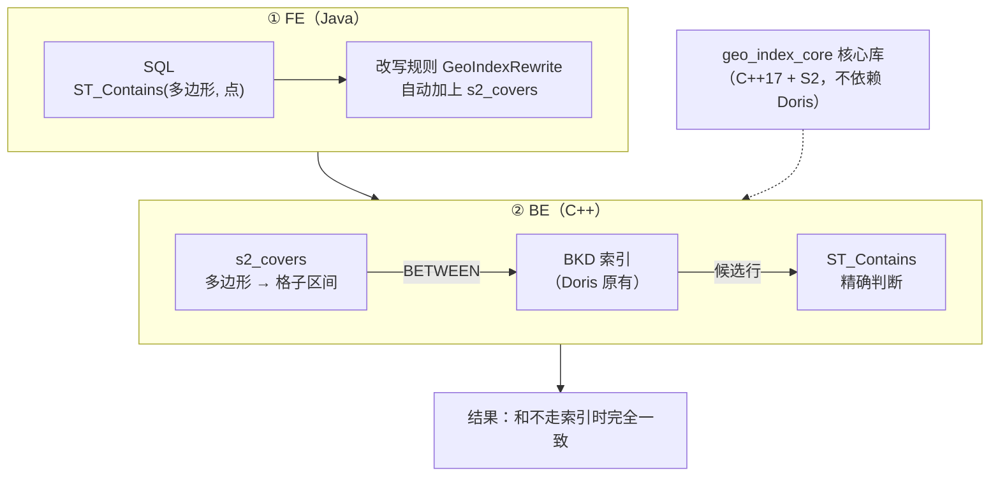
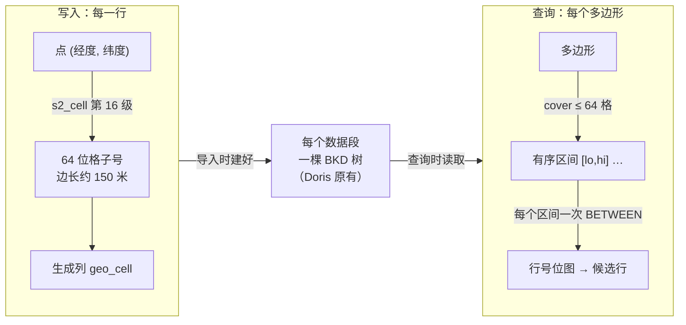

# Doris 地理空间索引 · 复盘（简版）

> 2026-11-19，c05，分支 bartuer/doris `geo-index`（主线 master + 31 个提交）。数字都是实测的。

## 0. 一句话结论

**没有新写索引，而是复用了 Doris 现成的东西**：用 S2 把经纬度换成一个 64 位的格子号，存进一个"生成列"，
再给这一列建 Doris 本来就有的数值倒排（BKD）索引。查询时，优化器自动把 `ST_Contains` 改写成
"先按格子粗筛 + 再精确判断"。1 亿个点时只扫 3.3% 的行，比全表扫快 7.5–10 倍，结果和不走索引时完全一致。

## 1. 为什么编译要 2620 个文件

| 部分 | 数量 | 说明 |
|---|---|---|
| BE 源码 `.cpp` | 1,415 | 整个 Doris 后端 |
| BE 单元测试 `.cpp` | 1,064 | `run-be-ut.sh` 会把测试一起编进去 |
| 生成代码 | 约 140 | thrift/protobuf 生成的文件 |
| **我们改的 BE 文件** | **11** | 另外 FE 8 个，核心库 15 个 |

- 我们只改了十几个文件，但 BE 是一个整体程序（`doris_be`），换了分支就要**整体重新编译一遍**
- 4.1 是新建的工作目录，编译缓存（ccache）是空的，所以第一次最慢
- 以后的提速办法：几个分支各用一台机器同时编；编译缓存共享（sccache）；分布式编译（distcc）

## 2. 架构

**设计取舍（F1–F5）**：不新增索引类型；核心库单独放一个目录（`contrib/geo_index_core`），方便移植到 4.1 和 3.1；
FE 里没有 S2 库，所以 FE 只做模式匹配，算格子的事都在 BE 做。

## 3. 数据结构

- **S2 格子号**：沿希尔伯特曲线编号，所以地理上挨着的格子号也挨着，一个多边形就能变成少量**连续区间**
- **为什么不用经纬度矩形（bbox）**：多边形的边在地球上是弯的（测地线）。城市多边形的边最多会鼓出 14.7 米，
  1 亿个点时 bbox 会**漏掉 763 个点**；S2 按测地线算，不会漏
- **按 geo_cell 排序建表**：区间对应的就是连续的行，又快了 24–37%

## 4. 实测结果（1 亿个点，32 核，缓存全关）

| 多边形 | 全表扫 | bbox 粗筛（会漏点） | 索引 + 按格子排序 | 扫描的行 | 快多少 |
|---|---|---|---|---|---|
| 城市 | 2,033 ms | 274 ms | **204 ms** | 3.3% | 比全表扫快 10 倍 |
| 细长 | 2,156 ms | 1,515 ms | **199 ms** | 4.6% | 比 bbox 快 7.6 倍 |
| 凹形 | 2,285 ms | 727 ms | **607 ms** | 14.6% | 比全表扫快 3.8 倍 |

- 代价：导入多花 16%，存储从 1.33 GB 增加到 1.93 GB
- 正确性：回归测试 `geo_index_p0` 显示，走索引和不走索引的结果完全一致；内存检查（ASAN/LSAN）无报错

## 5. 教训

1. **先测，再造**：一开始打算自己写索引。一测发现现成的 BKD 加一个生成列就够了，省下了整个写入端的代码
2. **bbox 看起来快，但结果不对**：测地线的边会鼓出去，没有测量的话这个错不会被发现
3. **目标要按实测来定**：原定"比 bbox 快 3 倍"。实测发现，对紧凑的多边形，bbox 就是扫描成本的下限，3 倍做不到，已经改成"更快且结果准确"
4. **性能分析开关会影响结果**："69 ms"其实是 profile 本身的开销，关掉后是 51 ms，因此省掉了一项缓存优化

## 6. 还没做的

- 移植到 4.1（正在 c05 编译）和 3.1（c07 已准备好）
- 内部覆盖（Z.3a，可选）：完全落在多边形内部的格子不用再精确判断，城市多边形预计还能再快约 1.5 倍
- 到线上实测：需要先确认线上跑的是哪个版本，以及怎么部署
